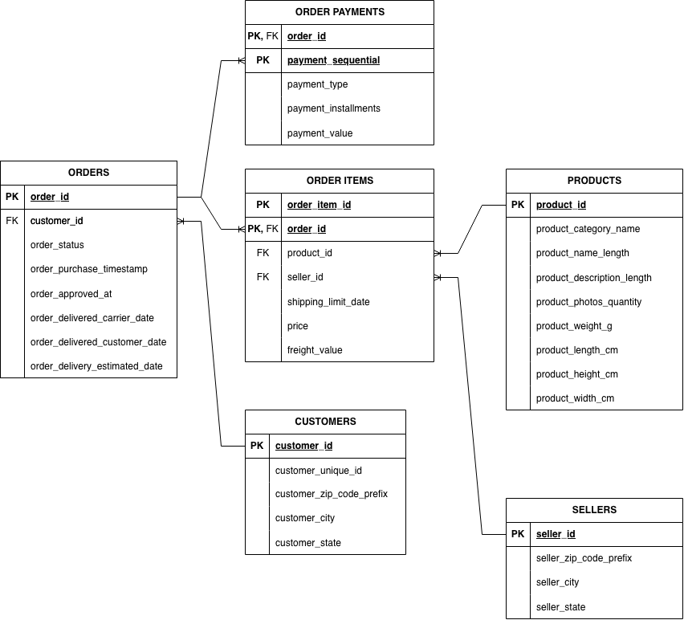
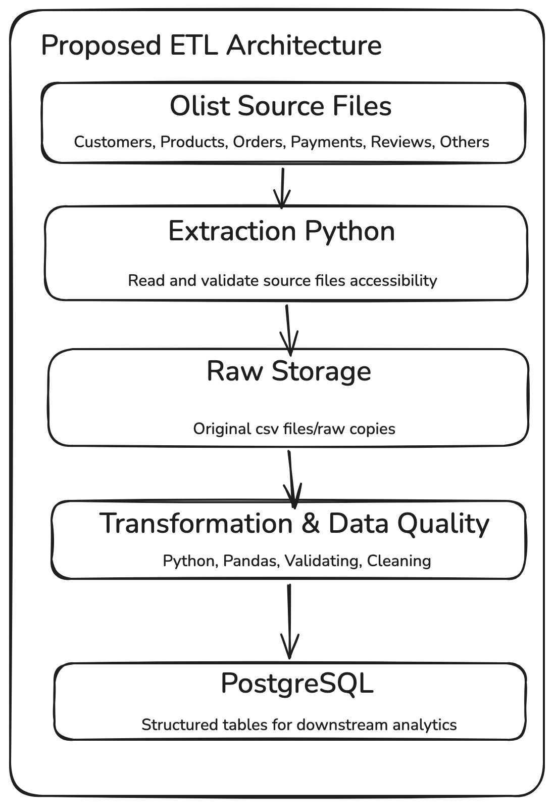

# Technical Design

## 1) Project Overview:
Olist Data engineering project, have the olist ecommerce dataset that includes: customers, orders, order items, payments, sellers, reviews, products and much more, project is asking to create the reliable ETL pipeline 

## 2) Business Requirements:
Design and build maintainable data pipeline that takes the olist dataset and makes validated, consistently structured data available for the analytics and other teams.

The solution should be repeatable, observable, and safe to run more than once. Another engineer should be able to understand, configure, run, test, and extend it.
## 3) Source Data Understanding:
1) **Dataset Overview:**
	Olist dataset is an collections of flat files(.csvs) that contains records of e-commerce domain includes customers, sellers, payments, orders, order items, products and much more, this dataset is mostly work-around e-commerce domain. This Dataset is downloaded from kaggle datasets
		
	
2) **Source Files:** 
	1) Customer
	2) Geolocation
	3) order items
	4) payments
	5) reviews
	6) orders
	7) products
	8) sellers
	9) product_category_name

3) **ER Diagram:**

4) Questions
	1) What tables exists?
		1) Main Tables are:
			1) Orders
			2) Order Items
			3) Order Payments
			4) Products
			5) Customers
			6) Sellers
		2) Other Tables:
			1) Product Category
			2) Reviews
			3) Geolocation
		3) > Right now we majorly focus on Main tables later part will see the other tables
	2) What are their relationships?
		- Orders Going to have multiple payments and multiple order items 
		- Customers going to have the multiple orders
		- Products going to have multiple order items
		- Sellers going to have multiple order items
	3) What are the primary keys and foreign keys
		1) Primary keys are identifier for unique records
		2) Foreign keys help to connect the other tables to create relationships
	4) How does the e-commerce domain works?
		1) E-commerce is the place where two parties made some transactions, it can be anything example for goods, services etc
		2) Generally, Customer place an order, orders going to have multiple items and then customer make payment of that order, and seller send the order to the customers
## 4) Proposed Architecture:

